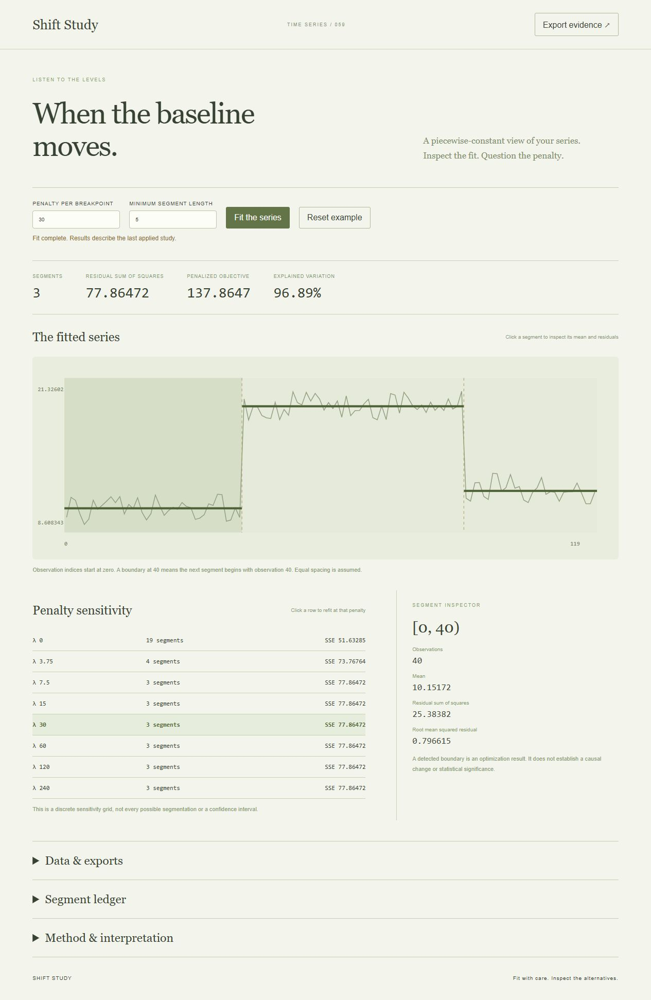

# Shift Study

A time-series workbench for penalized changes in level. Fit a piecewise-constant series, inspect each segment, and compare how the optimum changes when additional breakpoints become more expensive.



## Run

```sh
python run.py --port 8000
```

Requires Python 3.10+ and a modern browser with module workers. Open http://127.0.0.1:8000. No runtime dependencies, accounts or external services.

```sh
npm test
npm run check
python -m unittest discover -s tests -p 'test_*.py'
```

Development checks use Node 22+. CI runs on Linux and Windows.

## Explore the fit

The reproducible synthetic example contains 120 observations with constructed level changes at indices 40 and 90. With penalty 30 and minimum length 5, the optimizer finds those boundaries, producing three segments and residual sum of squares 77.86471527198012. The objective adds two breakpoint penalties for a total near 137.86471527.

Select a segment by mouse or keyboard to inspect its mean, count, SSE and root mean squared residual. Click a penalty-sensitivity row to refit. At penalty 3.75 the example uses four segments; a penalty of 10¹² selects one. Import observations as a JSON array or load a complete study. Export the last applied input, full numerical evidence, or observed/fitted/residual CSV rows.

Indices are zero-based; intervals are start-inclusive and end-exclusive. A boundary at 40 means observation 40 starts the next segment. Observations are equally spaced; no timestamps are interpreted.

## Objective and algorithm

The objective is:

`sum(segment squared residuals about its mean) + penalty × number of breakpoints`

The dynamic program evaluates every feasible previous boundary, enforcing the minimum length for every segment, including the first and last. It finds a global optimum of the **computed floating-point segment costs**. Exact cost ties prefer fewer segments, then the earliest final boundary encountered. This is optimal partitioning without PELT pruning or greedy splitting.

All interval SSEs are precomputed using a centered online variance recurrence. The initial prefix cost is zero, with the breakpoint penalty applied only when a previous segment exists. This avoids subtracting and re-adding a very large penalty around a small initial SSE. Floating-point calculations remain approximate; this is not rational arithmetic or a formal numerical certificate.

One fit takes O(n²) time, with O(n²) cached interval costs. A bounded penalty grid reuses that cache and performs at most eight fits. The grid includes zero and selected multiples of the current penalty, clipped to the allowed bound. It does not enumerate every possible segmentation or produce uncertainty intervals. Increasing the penalty cannot improve the tradeoff by selecting more segments in the exact objective; finite-precision ties can affect boundary choices.

## Interpretation and limits

The penalty has squared-data units. Scaling observations by c calls for scaling it by c² to preserve the relative objective. Larger penalties discourage breakpoints; minimum length imposes a separate structural restriction.

Detected boundaries do not establish causality or statistical significance. Squared-error fitting is sensitive to outliers, and trends or correlated noise can be approximated by artificial level changes. Explained variation is descriptive in-sample fit, not predictive accuracy; it is undefined for a constant series and displayed as a dash. The tool does not automatically select a scientifically justified penalty, forecast, model seasonality or handle irregular sampling.

Use 2–600 finite values within ±1,000,000, minimum segment length 1–50 no greater than the series length, and penalty 0–10¹². Files are limited to 100 KB. Editing controls does not change the current fit until applied. All processing runs in a browser worker; the local server serves only static assets.

## Verification and implementation

Nine Node tests cover known changes, constant-series tie handling, minimum lengths, a large-penalty cancellation regression, translation/scaling behavior, residual accounting, validation and penalty-count monotonicity. Three hundred short series are compared with exhaustive enumeration of all feasible partitions. A Python HTTP test checks static-asset restrictions, Host validation and response headers.

Browser checks cover segment selection, low/high penalties and evidence/CSV exports. An independent Python dynamic program using direct mean and squared-residual sums confirms the default boundaries and objective; all 120 CSV observations, fits and residuals are checked.

`core.js` contains interval costs, dynamic programming and sensitivity analysis. `worker.js` isolates computation from interaction. `app.js` manages plots, segment inspection and exports. `run.py` serves the app on loopback.

Background: [Lancaster's optimal-partitioning changepoint notes](https://www.lancaster.ac.uk/~romano/teaching/2425MATH337/3_multiple_changes.html).
